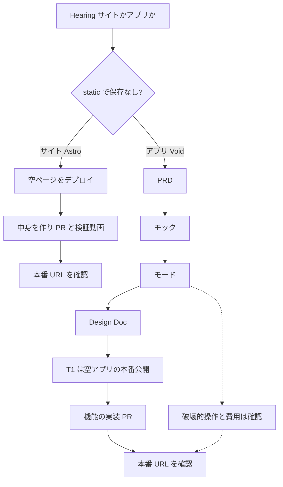

# mamestack

個人開発のための、再現できるソフトウェア工場である。AI コーディングボット（まず Grok Bot と Cursor のエージェント）が、ヒアリングから Cloudflare への公開までを、決まった順で進める。正本はこのリポジトリで、会話の記憶ではない。

A version-controlled factory for personal software. Hearing chooses a website or an app. A website (Astro, nothing stored) goes from the hearing note straight to implementation: deploy an empty page with Wrangler, build it, record one pull request, and check the production URL. An app (Void) keeps the full path: PRD, HTML mock, mode, design, tickets starting with an empty production deploy, implementation, and deploy. Websites use Astro and Wrangler. Applications use Void. App deploy is `cf` or the Void CLI, not Wrangler.

This repository is the factory itself. It is not a hosted app and not an npm library. `npm install` only installs Playwright, which the verification-video script needs. License: [MIT](LICENSE).

正本（canonical）: https://github.com/EringiV3/mamestack 。Cursor Origin の `mametaro/mamestack` はこの GitHub リポジトリのミラーです。Issue と Pull Request は GitHub へ。

## 初めて来た人へ

クローンしただけで使えます。アカウントも、このリポジトリに含まれる秘密もありません。`.env` は git に入れないでください。Cloudflare や Void のトークンをここに書かないでください。

```sh
git clone https://github.com/EringiV3/mamestack.git
cd mamestack
npm install
npx playwright install chromium
npm test
```

`npm test` が通れば、工程ゲートとサンプル「麦畑ベーカリー」の文書・動画の整合が取れています。画面録画を作り直すときは `npm run example:record` です。

自分のプロダクトに工場を入れる手順は [docs/adoption.md](docs/adoption.md)。エージェントには、リポジトリのルートで次だけ頼んでください。

```text
mamestack で始めて。AGENTS.md のヒアリングから、一問ずつ。
```

English, short: clone, install, `npm test`. Then copy `AGENTS.md`, `.cursor/`, `templates/`, `tools/`, and the how-to files in `docs/` into your product. Do not copy `examples/`. `init` places `templates/prd.md` and `templates/design-doc.md` at `docs/prd.md` and `docs/design-doc.md`. Tell the agent to follow `AGENTS.md` and ask one hearing question at a time. The sample in `examples/kiosk-hours/` is a finished bakery hours page you can replay; it was not deployed, because Cloudflare’s `cf` beta does not build Astro 6+ and this sample has no Cloudflare account.

## 工程

アプリは飛ばさない。ゲートが、前の承認が無い状態を保存できない。サイトだけは、ゲートが PRD からチケットまでを飛ばして実装に入る。



1. **Hearing** — 何を作るか、誰が使うか、サイトかアプリか、機能（数に上限はない。v1 と、明示した後回し）、保存するデータ、見た目、独自ドメイン。一問ずつ。答えは `docs/00-hearing.md` に短く残す。
2. **サイト** — 承認は取らない。空ページを先に `npm run deploy`（固定バージョンの Wrangler）し、中身を作り、PR の検証動画と本番 URL の確認まで進む。PRD、モック、モード、設計書、チケット分割は飛ばす。
3. **アプリの PRD** — `templates/prd.md` を `docs/prd.md` に写して埋める。不足だけを1回3問まで聞き、OK まで進まない。機能の数に上限はない。挙がった機能はすべて書き、明示して後回しにしたものだけを次の版のメモにする。自分だけが使うときは、収益モデル、プライシング、GTM、差別化、収益・グロースの成功指標は「該当なし（自分用）」。インフラは無料枠。
4. **モック** — PRD の画面フローと P0 だけを、依存なしの HTML で `docs/mockup/` に置く。スマホ幅と PC 幅のスクショを見せ、OK をもらう。イメージと大まかな UI のすり合わせであり、見た目の正にはしない。
5. **モード** — アプリだけ。full-auto はボットが設計・チケット・実装を進める。approval は設計書、粒度、各 PR を人が見る。どちらでも、データを壊す操作と費用が出る操作は確認する。
6. **設計書** — アプリだけ。認証、課金、ドメインなど利用者にしか決められないことだけ聞く。モックは参考程度。
7. **チケット** — アプリだけ。T1 は空のアプリを本番に出す。その後 v1 の機能。各 PR のあと本番に出せる状態を保つ。
8. **デプロイ** — 本番 URL で表示を確認する。未検証のコマンドは実行しない。サイトは Wrangler、アプリは `cf` か Void CLI。

## フレームワーク

| 作るもの | 使うもの | 公開 |
| --- | --- | --- |
| ウェブサイト | Astro | Cloudflare。`cf` |
| アプリケーション | Void SDK | Cloudflare。Void CLI |

詳細は [docs/framework-selection.md](docs/framework-selection.md)。公開コマンドの、公式で確認できた範囲と TODO は [docs/cloudflare-deploy.md](docs/cloudflare-deploy.md)。

2026-11-03 時点で、Cloudflare は `cf` をベータとし、Astro 6 以降は `cf` でビルドできない、と書いている。npm の Astro はその日 7 系だった。サイト（Astro）のビルドとデプロイは Wrangler で行う。アプリは Wrangler を使わない。

## リポジトリ

```text
AGENTS.md                         エージェントが従う工程
.cursor/rules/mamestack.mdc       常時の短い拘束
.cursor/skills/mamestack/SKILL.md スキルの入口
templates/                        要求まとめ、PRD、Design Doc、チケット、PR
docs/                             採用、モード、選定、デプロイ、検証動画、出典
tools/gate/                       工程を飛ばせない状態機械とテスト
tools/verify-record/record.mjs    Playwright で検証動画を録る
examples/kiosk-hours/             麦畑ベーカリー。全文書と録画の実例
```

## ローカルで再生する

Node.js 22.18 以上。Astro 本体を作る場合、Astro 公式は v22.23.4 以上（奇数版は非対応）としている。

```sh
npm install
npx playwright install chromium
npm test
npm run example:record
npm run example:check
```

`npm test` はゲートの単体テスト。`example:record` はサンプルの二本の WebM を作り直す。`example:check` は、サンプルの状態ファイルが文書と動画に対して整合しているかを見る。

サンプルの読み方は [examples/kiosk-hours/README.md](examples/kiosk-hours/README.md)。

## 自分のプロダクトに入れる

[docs/adoption.md](docs/adoption.md)。要約すると、`AGENTS.md` と `.cursor/` と `templates/` と `tools/` と手順の `docs/` をプロダクトへコピーし、`examples/` はコピーしない。最初の依頼は次で足りる。

```text
mamestack で始めて。AGENTS.md のヒアリングから、一問ずつ。
```

エージェントは `node tools/gate/cli.mjs next --root .` の表示以外の質問を足さない。

## 動画にするなら

章は工程と揃えると、見ている人がリポジトリを追える。麦畑のサンプルは、サイト短縮の前に録ったフルコースの写しである。新しいサイトは PRD からチケットを飛ばす。

1. この README の図を見せ、正本は会話ではなく git だと言う。
2. 麦畑のヒアリングを、一問ずつゲートが拒む様子とともに。
3. PRD を出して、OK まで打たない。
4. 静的 HTML モックを、スマホ幅と PC 幅のスクショとともに見せ、OK まで打たない。
5. full-auto と approval の違い。費用と削除はどちらでも止まると言う。
6. 設計書で Astro に決まること。サイトの公開は Wrangler、という判断。
7. チケット二枚。later の「スマホで売り切れ」はゲートが登録を拒む。
8. `npm run example:record` のターミナルと、できた WebM。PR テンプレートの三行。
9. `guard` が `cf deploy` と `npm run deploy` を confirm にし、アプリの `wrangler` を forbidden にするところ。サイトの Wrangler は `npm run deploy` の中で使う。

## 確認済みと、まだ実行していないこと

出典の一覧は [docs/sources.md](docs/sources.md)。

確認してこのリポジトリに含めたもの: ゲートのテスト、サンプルページに対する Playwright の録画。

公式を読んでコマンド名を書き、この環境では実行していないもの: `cf auth login`、`cf deploy`、`void init`、`void deploy`、`npm create astro`。資格情報が無く、Astro と `cf` の組み合わせは公式が未対応と書いているため。未検証のフラグは TODO として [docs/cloudflare-deploy.md](docs/cloudflare-deploy.md) に残してある。

## ライセンス

[MIT](LICENSE)。Copyright (c) 2026 Kodai Hagihara. コード、文書、サンプルのページと検証動画を、このライセンスの条件で使ってよい。
